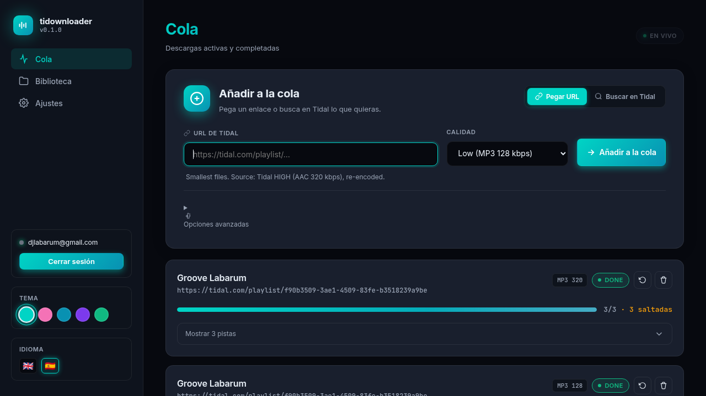
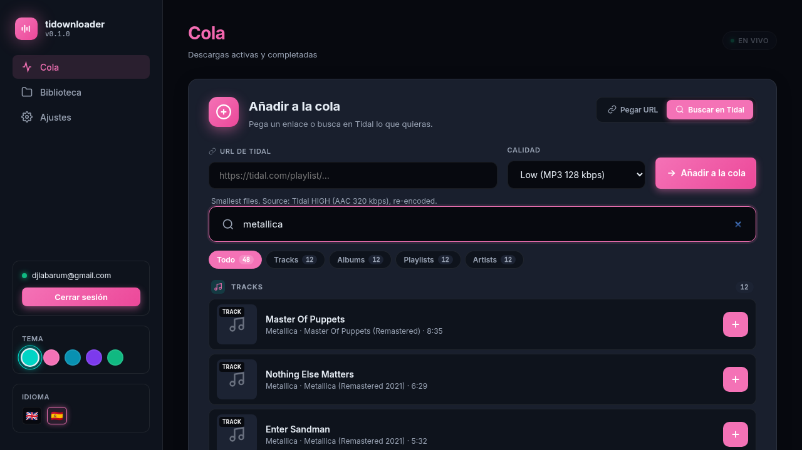
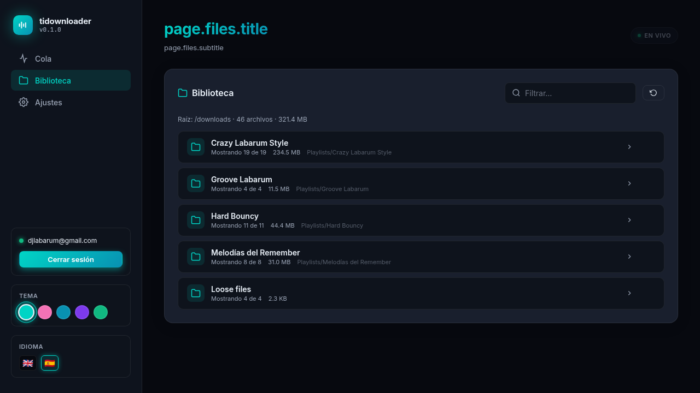
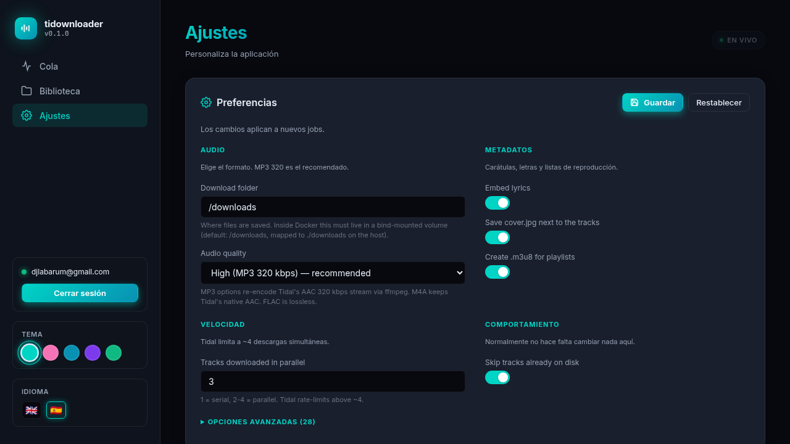

<p align="center">
  
</p>

<h1 align="center">tidownloader</h1>

<p align="center">
  <strong>Self-hosted music downloader for your Tidal subscription.</strong>
  <br>
  Lossless FLAC, MP3 320, M4A, search, themes, multi-language, file manager.
  <br><br>
  <a href="https://github.com/javiservices/tidownloader"></a>
  <a href="https://github.com/javiservices/tidownloader/blob/main/LICENSE"></a>
  <a href="https://github.com/javiservices/tidownloader/pkgs/container/tidownloader"></a>
  <a href="https://github.com/javiservices/tidownloader/actions"></a>
  <a href="https://github.com/javiservices/tidownloader"></a>
</p>

<p align="center">
  <a href="#-features">Features</a> &nbsp;·&nbsp;
  <a href="#-screenshots">Screenshots</a> &nbsp;·&nbsp;
  <a href="#-quick-start">Quick start</a> &nbsp;·&nbsp;
  <a href="#-configuration">Configuration</a> &nbsp;·&nbsp;
  <a href="#-api">API</a> &nbsp;·&nbsp;
  <a href="#-development">Development</a> &nbsp;·&nbsp;
  <a href="#-license">License</a>
</p>

---

## ✨ Features

- 🎵 **All the formats Tidal serves** — MP3 128/256/320, M4A (AAC 320), FLAC lossless
- 🔍 **Built-in search** for tracks, albums, playlists, artists and videos
- 📋 **Single quality selector** with smart fallback (HI_RES → LOSSLESS automatically)
- 📁 **File manager** — browse, delete files and entire folders
- 🎨 **5 themes** — 2 dark + 3 light variants, all with smooth transitions
- � **Multi-language** — English & Spanish out of the box, easy to extend
- � **Per-track live progress** with segment-level percentage
- 🚀 **Concurrent downloads** within a job (1–4 tracks in parallel)
- 🐳 **Docker Compose ready** — bind mounts for downloads, queue, and session
- 🔒 **OAuth device-link login** — no passwords stored, uses your Tidal subscription
- 💾 **Stateful queue** — survives container restarts (SQLite)
- 🎵 **Metadata tagging** — ID3v2 for MP3, FLAC tags for lossless, MP4 atoms for M4A
- 🖼️ **Cover art** embedded + sidecar `cover.jpg` per album
- 🎼 **M3U8 playlists** generated automatically
- 📝 **Lyrics embedding** when available
- �️ **Keyboard shortcuts** (`/` to focus URL, `Esc` to close modals)

## 📸 Screenshots

### Queue with per-track progress (light theme)
<p align="center"></p>

### Search Tidal — grouped by type with filter chips
<p align="center"></p>

### Library — file manager with tree view and delete actions
<p align="center"></p>

### Settings — minimal essential fields, advanced collapsible
<p align="center"></p>

### Themes — 5 variants, pick your vibe

| | | |
|---|---|---|
| 🟦 **Dark Cyan** (default) | � **Dark Magenta** | ⬜ **Light Cyan** |
| 🟪 **Light Violet** | 🟩 **Light Mint** | |

## 🚀 Quick start

### Docker Compose (recommended)

```bash
git clone git@github.com:javiservices/tidownloader.git
cd tidownloader
docker compose up -d --build
# Open http://localhost:8000
```

That's it. The app boots, you log in with Tidal, and you're done.

Downloads land in `./downloads/` (bind-mounted). The session + queue database persist in `./data/`.

### Bare metal

```bash
git clone git@github.com:javiservices/tidownloader.git
cd tidownloader
python3 -m venv .venv
.venv/bin/pip install -e .

# CLI
.venv/bin/tidownloader --login
.venv/bin/tidownloader https://tidal.com/playlist/<uuid>

# Web UI
.venv/bin/tidownloader-web --port 8000
# Open http://localhost:8000
```

## ⚙️ Configuration

All settings live in `./data/config.json` and are editable from the web UI (`Settings` tab). The first thing you'll see:

| Setting | Default | What it does |
| --- | --- | --- |
| **Download folder** | `/downloads` | Where files land. Must be a Docker bind-mount. |
| **Quality** | `mp3_320` | `mp3_128`, `mp3_256`, `mp3_320`, `m4a`, or `flac` |
| **Embed lyrics** | ✓ | Fetch and embed lyrics in tags |
| **Cover.jpg sidecar** | ✓ | Save `cover.jpg` next to tracks |
| **Concurrent downloads** | `1` | Tracks in parallel (1–4, Tidal rate-limits beyond) |
| **Skip existing files** | ✓ | Don't re-download if already on disk |

Everything else (folder template, filename template, padding, padding, M3U8, fallback language, retry count, etc.) lives in the **Advanced** disclosure.

### Quality → Tidal API mapping

| User-facing | Source from Tidal | Re-encoded? | Notes |
| --- | --- | --- | --- |
| `mp3_128` | HIGH (AAC 320) | ✓ → MP3 128 | Smallest files |
| `mp3_256` | HIGH (AAC 320) | ✓ → MP3 256 | Balanced |
| `mp3_320` (default) | HIGH (AAC 320) | ✓ → MP3 320 | Best MP3 |
| `m4a` | HIGH (AAC 320) | — | Tidal's native AAC |
| `flac` | HI_RES_LOSSLESS → LOSSLESS | — | Lossless, with FLAC fallback |

> **Note**: Tidal doesn't serve MP3 natively — only AAC inside M4A. The MP3 options re-encode the lossy AAC stream with `ffmpeg`.

### Folder & filename templates

```
{albumartist}    {artists}        {album}        {title}
{tracknum}       {discnum}        {year}         {date}
{isrc}           {upc}            {quality}      {ext}
{playlist}       {playlistnum}    {playlistowner}
```

Default album folder is `{albumartist} - {album}`, default filename is `{tracknum:02d} - {title}`. Override from Settings → Advanced.

## 📡 API

All endpoints under `/api/`. JSON in, JSON out.

### Auth

| Method | Path | Description |
| --- | --- | --- |
| GET | `/api/auth/status` | Current login state |
| POST | `/api/auth/login` | Start OAuth device flow, returns URL + code |
| POST | `/api/auth/logout` | Clear the session |

### Downloads

| Method | Path | Body |
| --- | --- | --- |
| GET | `/api/downloads` | — |
| POST | `/api/downloads` | `{url, quality?, download_path?}` |
| GET | `/api/downloads/{id}` | — |
| DELETE | `/api/downloads/{id}` | — |
| POST | `/api/downloads/{id}/retry` | — |

### Search

| Method | Path | Body |
| --- | --- | --- |
| GET | `/api/search?q=metallica` | — |

Returns tracks, albums, playlists, artists and videos with their canonical Tidal URL.

### Library

| Method | Path | Description |
| --- | --- | --- |
| GET | `/api/files` | Flat list |
| GET | `/api/files/tree` | Grouped by folder (for the file manager) |
| GET | `/api/files/{path}` | Download a single file |
| DELETE | `/api/files/file/{path}` | Remove a file |
| DELETE | `/api/files/folder/{path}` | Remove a folder recursively |

### Settings & misc

| Method | Path | Description |
| --- | --- | --- |
| GET | `/api/settings` | Current settings + UI schema |
| PUT | `/api/settings` | Update settings (JSON merge) |
| POST | `/api/settings/reset` | Restore defaults |
| GET | `/api/themes` | List of available UI themes |
| GET | `/health` | Health probe |

### Example: search and queue

```bash
# Find an album
curl 'http://localhost:8000/api/search?q=coldplay' | jq '.results[] | select(.kind == "album")'

# Queue the first hit
curl -X POST http://localhost:8000/api/downloads \
  -H 'Content-Type: application/json' \
  -d '{"url": "https://tidal.com/album/12345", "quality": "flac"}'
```

## 🐳 Docker Compose reference

```yaml
services:
  tidownloader:
    build: .
    image: tidownloader:latest
    container_name: tidownloader
    restart: unless-stopped
    ports: ["8000:8000"]
    volumes:
      - ./downloads:/downloads     # downloads land here on the host
      - ./data:/data               # Tidal session + queue database
    healthcheck:
      test: ["CMD", "curl", "-fsS", "http://localhost:8000/api/health"]
      interval: 30s
```

The `data/` volume is critical — losing it means re-logging in to Tidal. Back it up.

## � Customisation

### Change the port

Edit `docker-compose.yml`:
```yaml
ports:
  - "9000:8000"   # host:container
```

### Change the download path

Either from **Settings → Download folder**, or per-job via the **Advanced** options on the add-form.

### Add a new language

Edit `src/tidownloader/web/static/i18n.js` and add a new entry:

```js
const I18N = {
  en: { ... },
  es: { ... },
  fr: {  // ← new
    "nav.queue": "File d'attente",
    ...
  },
};
```

Then register it in `AVAILABLE_LOCALES`:

```js
const AVAILABLE_LOCALES = [
  { code: "en", label: "English", flag: "🇬🇧" },
  { code: "es", label: "Español", flag: "🇪🇸" },
  { code: "fr", label: "Français", flag: "🇫🇷" },
];
```

Done. The sidebar language switcher picks it up automatically.

## 🛠️ Development

### Run from source

```bash
git clone git@github.com:javiservices/tidownloader.git
cd tidownloader
python3 -m venv .venv
.venv/bin/pip install -e '.[dev]'  # or just pip install pytest flask tidalapi...
```

### Test suite

```bash
.venv/bin/pytest tests/ -v
```

Tests cover:
- URL parsing for all Tidal entity kinds
- AES-CTR + CBCS decryption round-trips
- End-to-end download with mocked Tidal API
- All web API endpoints
- Worker thread runs jobs and updates state
- Per-track progress serialization

### Project layout

```
tidownloader/
├── src/tidownloader/
│   ├── auth.py         OAuth device-link + session persistence
│   ├── api.py          URL parsing, fetching, search
│   ├── config.py       Settings dataclass + JSON persistence
│   ├── templates.py    Filename/folder template rendering
│   ├── manifest.py     DASH manifest, AES decryption, ffmpeg
│   ├── metadata.py     FLAC/MP3/M4A tagging, cover art, M3U8
│   ├── downloader.py   Per-track download orchestration
│   ├── web/            Flask app + JSON API + worker thread
│   │   ├── server.py
│   │   └── queue.py
│   └── cli.py          argparse CLI
├── static/
│   ├── favicon.svg     Tidal-wave favicon
│   ├── app.css         Theme system + animations
│   ├── app.js          UI logic + DOM patching
│   └── i18n.js         Translations (en/es)
├── docs/screenshots/   README images
├── tests/
├── Dockerfile
├── docker-compose.yml
└── pyproject.toml
```

## ⚠️ Notes

- This tool uses **your own Tidal subscription**. You need an active HiFi or HiFi Plus plan for FLAC / hi-res.
- FLAC files are decrypted from Tidal's CDN using their own key service (standard Common Encryption / `cenc` AES-CTR).
- Tidal allows only one active stream per session, so the worker is single-threaded per job. Within a job you can run 1–4 tracks concurrently.
- Tidal's API occasionally changes. If something breaks, open an issue with verbose logs (`-v`).

## 📜 License

MIT — see [LICENSE](LICENSE).

---

> 💡 This project is for personal use with content you have already paid for through Tidal. Do not redistribute downloaded files.
